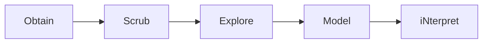

# Markdown Cheat Sheet

## Contents

- [Text](#text)
- [Lists](#lists)
- [Links and images](#links-and-images)
- [Code](#code)
- [Quotes](#quotes)
- [Tables](#tables)
- [Layout](#layout)
- [GitHub extras](#github-extras)
- [Pitfalls](#pitfalls)

---

## Text

### Italic and bold

**CommonMark** · One star for italic, two for bold, three for both

```
*italic*, **bold**, ***both***
```
*italic*, **bold**,***both***

### Escaping a character

**CommonMark** · A backslash shows a special character literally instead of formatting.

```
\*not italic\*
```
\*not italic\*

### Headings

**CommonMark** · A heading is marked with a `#` followed by a space and then the text. You can use one to six hashtags for different level of the Heading

```
#### This is a heading!
```
#### This is a heading!

### Paragraphs and line breaks

**CommonMark** · A Paragraph starts when using an empty line. Text, empty line, Text. A backslash force a line break inside a paragraph
```
First line\
second line, same paragraph

A new paragraph.
```
First line\
second line, same paragraph

A new paragraph.

### Strikethrough

**GitHub** · Two tildes on each side cross text out
```
~~no longer true~~
```
~~no longer true~~

### Inline Code

**CommonMark** · Backticks mark code inside a sentence; Markdown inside them is not interpreted
```
Run `pd.read_csv()` to load a file.
```
Run `pd.read_csv()` to load a file.

## Lists

### Unordered, ordered and nested lists

**CommonMark** · `-` or `*` for buttel points, `1.` for numbered items; indent to nest
```
1. Obtain
   - open data
   - web scraping
2. Scrub
```
1. Obtain
   - open data
   - web scraping
2. Scrub

### Task Lists

**GitHub** · `[ ]` and `[x]` after a list marker make checkboxes.
```
- [x] Lab repository
- [ ] Cheat sheet
```
- [x] Lab repository
- [ ] Cheat sheet
## Links and images

### Inline and reference-style links

**CommonMark** · Inline links put the URL in brackets right after the text; reference-style links define the URL once, elsewhere.
```
[Course website](https://breuert.github.io/data-integration/) and [the course repo][course].

[course]: https://github.com/breuert/data-integration
```
[Course website](https://breuert.github.io/data-integration/) and [the course repo][course].

[course]: https://github.com/breuert/data-integration

### Relative link to another file

**CommonMark** · A path instead of a URL links to a file in the same repository.
```
[My licence](../../LICENSE)
```
[My licence](../../LICENSE)

### Link to a section

**GitHub** · GitHub gives every heading an anchor: lower case, space beome `-`.
```
[Jump to Tables](#tables)
```
[Jump to Tables](#tables)

### Image with alt text

**CommonMark** · Like a link with `!` in front; the text in brackets is the alt text.
```

```


### Image that is a link

**CommonMark** · Put the image inside the brackets of a link.
```
[](https://github.com)
```
[](https://github.com)

## Code

### Fenced code blocks with syntax highlighting

**CommonMark** · Three backticks open and close a block; the language name after them is standard, the colours are added by GitHub.
````markdown
```python
import pandas as pd
df = pd.read_csv("bikes.csv", sep=";")
```
````

```python
import pandas as pd
df = pd.read_csv("bikes.csv", sep=";")
```

````markdown
```bash
curl -O https://example.org/data.csv
```
````

```bash
curl -O https://example.org/data.csv
```

````markdown
```json
{"station": "Köln/Bonn", "temperature": 12.3}
```
````

```json
{"station": "Köln/Bonn", "temperature": 12.3}
```
## Quotes

### Blockquotes, nested and with formatting

**CommonMark** · `>` starts a quote, ``>>`` nests one; formatting works inside.
```
> A quote with **bold** text
>> and a nested quote
```
> A quote with **bold** text
>> and a nested quote

### Alerts

**GitHub** · A blockquote that starts with `[!NOTE]`, `[!TIP]`, `[!IMPORTANT]`, `[!WARNING]` or `[!CAUTION]` becomes a coloured box.
```
> [!NOTE]
> Set up your lab repository before 30.10.
```
> [!NOTE]
> Set up your lab repository before 30.10.

## Tables

### Table with aligned columns, a link and a pipe

**GitHub** · Pipes separate columns; colons in the second row align them; `\|` shows a literal pipe.
```
| Left | Centre | Right |
| :--- | :---: | ---: |
| [pandas](https://pandas.pydata.org) | a \| b | 42 |
```
| Left | Centre | Right |
| :--- | :---: | ---: |
| [pandas](https://pandas.pydata.org) | a \| b | 42 |

## Layout

### Horizontal rule

**CommonMark** · Three dashes on their own line draw a line.
```
---
```
---

### Collapsed section

**CommonMark** · HTML `<details>` and `<summary>` hide content until clicked (HTML is passed through).
```
<details>
<summary>Click me</summary>

Hidden text.

</details>
```
<details>
<summary>Click me</summary>

Hidden text.

</details>

### Comments that do not render

**CommonMark** · An HTML comment stays in the source but is invisible.
```
<!-- This is invisible -->
```
<!-- This is invisible -->
(Nothing visible above this line.)

## Github extras

### Footnotes

**GitHub** · `[^1]` marks a footnote; its text goes anywhere in the file.
```
Open data needs a licence.[^1]

[^1]: For example CC BY 4.0.
```
Open data needs a licence.[^1]

[^1]: For example CC BY 4.0.

### Emoji shortcodes

**GitHub** · A name between colons becomes an emoji.
```
:bike: :sunny:
```
:bike: :sunny:

### @mentions and issue references

**GitHub** · `@user` links a person, `#1` links issue 1 of this repository.
```
Thanks @breuert, see #1.
```
Thanks @breuert, see #1.

### Mermaid diagram

**GitHub** · A code block with the language `mermaid` is drawn as a diagram.

````

````


### Formula

**GitHub** · LaTeX between `$` (inline) or `$$` (block) is rendered as maths.

```markdown
Correlation $r = 0.90$, and as a block:

$$\bar{x} = \frac{1}{n}\sum_{i=1}^{n} x_i$$
```

Correlation $r = 0.90$, and as a block:

$$\bar{x} = \frac{1}{n}\sum_{i=1}^{n} x_i$$

## Pitfalls

1. **Unclosed code block.** In my first draft I forgot the closing ``` ``` ```, so everything after it was shown as code. Fix: every fenced block needs three closing backticks on their own line.
2. **Showing the source of a code block.** Three backticks around a block that itself contains three backticks ended the outer block too early. Fix: use four backticks ```` ```` ```` for the outer fence.
3. **Horizontal rule seemed to be missing in the dingus.** I could not see the line in the preview. Fix: the HTML tab showed `<hr />`, so it works; the line is just very thin.
